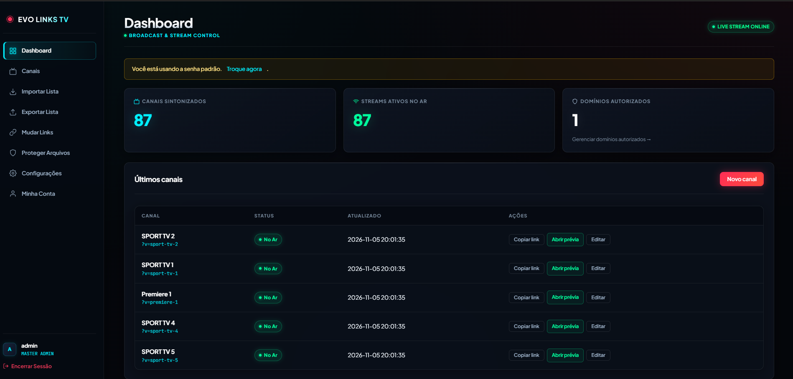
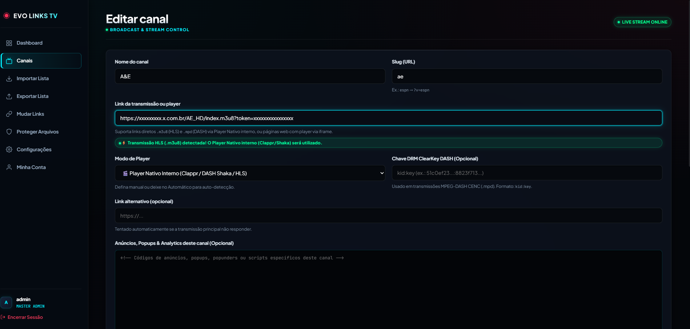
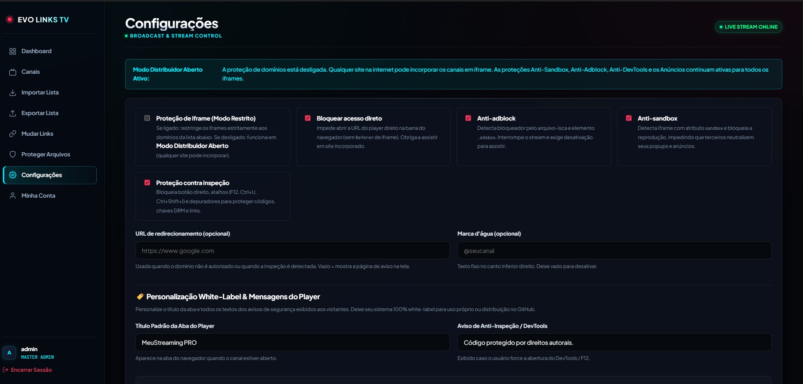

# 📡 EVO LINKS TV — Plataforma Profissional de Transmissão, Gestão e Proteção de Streams

<p align="center">
  
</p>

<p align="center">
  
  
  
  
  
</p>

---

## 📖 Visão Geral

O **EVO LINKS TV** é um sistema corporativo completo para emissoras, produtores de conteúdo, portais de esportes e operadoras de streaming que necessitam de **gestão centralizada de canais, distribuição escalável e proteção avançada contra pirataria e roubo de sinal**.

Construído com foco em **alta performance**, **baixo consumo de recursos** e **compatibilidade universal** (cPanel, Hospedagens Compartilhadas, VPS e servidores dedicados), o sistema oferece uma suíte completa de ferramentas que vão desde a importação assistida por Inteligência Artificial até a proteção em tempo real contra iframes não autorizados, depuradores DevTools e bloqueadores de anúncios.

---

## 📸 Demonstração Visual do Sistema

### 1. Painel de Controle & Monitoramento em Tempo Real
Central de comando com visualização imediata da quantidade de canais sintonizados, transmissões ativas no ar, domínios autorizados e atalhos rápidos de cópia de link, pré-visualização e edição.

<p align="center">
  
</p>

### 2. Gerenciador de Canais, DRM ClearKey & Player Nativo
Configuração intuitiva de transmissões diretas **HLS (.m3u8)** e **MPEG-DASH (.mpd)** com auto-detecção de formato, suporte a chaves **ClearKey DRM**, URLs de backup automático e injeção de anúncios específicos por canal.

<p align="center">
  
</p>

### 3. Blindagem de Segurança, Anti-Sandbox & White-Label
Controle granular sobre os modos de distribuição (Restrito a domínios parceiros ou Distribuidor Aberto), proteção contra inspeção F12/DevTools, sistema anti-sandbox, anti-adblock e personalização completa de títulos e mensagens.

<p align="center">
  
</p>

---

## ⚡ Principais Funcionalidades

### 🎬 1. Motor de Streaming Híbrido & Inteligente
- **Auto-Detecção de Transmissão:** O sistema identifica automaticamente se a URL informada é uma transmissão direta HLS/DASH ou uma página incorporável via iframe.
- **Player Nativo HLS & DASH Integrado:** Equipado com Clappr e Shaka Player UI moderno, com seletor automático de qualidade, picture-in-picture (PiP) e buffer adaptativo.
- **Suporte a DRM ClearKey (MPEG-DASH):** Suporte nativo ao formato `kid:key` para reprodução segura de conteúdos criptografados.
- **Failover / Link Backup Automático:** Se a transmissão primária oscilar ou sair do ar, o player tenta automaticamente o link de contingência sem interrupção para o usuário.
- **Ofuscação Criptográfica em Runtime:** A URL real do stream e os parâmetros são criptografados no servidor via **AES-256-GCM** e descriptografados dinamicamente na memória do navegador, impedindo a cópia via "Exibir código-fonte".

### 🛡️ 2. Proteção Anti-Pirataria em Camadas
- **Bloqueio de Acesso Direto:** Impede que internautas abram o link do player diretamente na barra de endereço, exigindo que o acesso ocorra via incorporação em sites permitidos.
- **Proteção de Iframe (Modo Restrito vs Distribuidor Aberto):**
  - *Modo Restrito:* Whitelist de domínios via `Content-Security-Policy (frame-ancestors)` e validação de `Referer`.
  - *Modo Distribuidor Aberto:* Permite que qualquer site na internet incorpore os streams, enquanto preserva e executa todas as suas defesas de anúncios e monetização.
- **Anti-Sandbox Heurístico:** Detecta se um site terceiro incorporou seu player com o atributo `<iframe sandbox>`, que tenta anular seus popups e redirecionamentos publicitários. Se detectado, o player interrompe o stream até que o sandbox seja removido.
- **Anti-AdBlock com Retomada Suave:** Isola bloqueadores através de arquivos-isca e elementos DOM armadilhados. O visitante é convidado a pausar o AdBlock para liberar a transmissão com apenas um clique.
- **Proteção Anti-Inspeção & Anti-DevTools:** Bloqueio de clique direito, atalhos de depuração (`F12`, `Ctrl+Shift+I`, `Ctrl+U`) e congelamento preventivo de depuradores ativos.
- **Marca d'água Dinâmica:** Inserção de marca d'água de canal (ex.: `@seucanal`) sobreposta ao vídeo.

### 💰 3. Monetização & Gestão de Anúncios
- **Anúncios Globais:** Código universal de anúncios (banners, popunders, analytics) inserido automaticamente em todos os canais do sistema.
- **Anúncios Específicos por Canal:** Capacidade de associar campanhas ou patrocinadores exclusivos a canais selecionados.
- **Sanitização de Código:** Tratamento de scripts e prevenção contra injeções acidentais.

### 🔄 4. Ferramentas em Massa & Produtividade
- **Importação Inteligente via IA (OpenRouter):** Cole uma lista bruta de canais ou arquivos de texto; o motor de IA normaliza nomes, detecta categorias e resolve slugs automaticamente.
- **Regra de Slugs Alternativos:** Prevenção automática de conflitos gerando sufixos organizados (`espn`, `espnop2`, `espnop3`, `sportv2`, `sportv2op2`).
- **Substituição de Links em Massa (Mass Replace):** Migre centenas de URLs ou padrões de domínio de uma só vez com modo **Simulação Prévia (Dry-Run / Diff)** antes de efetivar alterações no banco.
- **Exportação Flexível:** Baixe relatórios e listas de canais em `.TXT` simples ou `.HTML` interativo com botões de cópia rápida de iframes.

### 🔌 5. API REST & Arquivos Protegidos Standalone
- **REST API JSON:** Endpoints autenticados via `X-API-Key` ou Bearer Token para consulta e sincronização remota do catálogo de canais com outros sistemas e CMSs.
- **Gerador de Arquivos Protegidos Avulsos:** Gere e baixe scripts PHP independentes (ex.: `canal.php`) com todo o motor de proteção embutido e código ofuscado para hospedar em múltiplos servidores.

### 🎨 6. 100% White-Label
- Totalmente personalizável: altere o nome do sistema, o título da aba do player, o logotipo da marca e os textos de avisos de segurança sem tocar no código-fonte.

---

## 🛠️ Requisitos do Servidor

| Requisito | Versão Mínima | Recomendado |
|---|---|---|
| **PHP** | 8.1+ | 8.2 ou 8.3 |
| **Banco de Dados** | MySQL 5.7+ ou MariaDB 10.3+ | MySQL 8.0+ / MariaDB 10.6+ |
| **Extensões PHP** | `pdo_mysql`, `openssl`, `curl`, `mbstring`, `json` | Ativas por padrão na maioria dos hosts |
| **Servidor Web** | Apache (com `mod_rewrite` ativo) ou Nginx | Apache 2.4+ / LiteSpeed / Nginx |
| **Permissões** | Pasta raiz e pasta `cache/` com permissão de escrita | `chmod 755` ou `775` |

---

## 🚀 Instalação Rápida

### Método 1: Via Instalador Web (Recomendado)

1. Faça o clone ou envie os arquivos do projeto para o diretório da sua hospedagem (ex.: `public_html` ou pasta do subdomínio):
   ```bash
   git clone https://github.com/marksjr/evolinkstv.git .
   ```
2. Crie um banco de dados MySQL no painel da sua hospedagem (ex.: cPanel > Bancos de Dados MySQL).
3. Acesse seu domínio pelo navegador:
   ```text
   https://seusite.com/install.php
   ```
4. O **Diagnóstico da Hospedagem** verificará automaticamente se o PHP e as extensões estão ativas.
5. Preencha as credenciais do banco de dados e os dados da sua conta de administrador.
6. Clique em **Instalar e Configurar Sistema**. A trava de segurança `install.lock` será criada automaticamente e o sistema estará pronto para uso.

---

### Método 2: Instalação Manual

1. Copie o arquivo [`config.example.php`](config.example.php) para `config.php`:
   ```bash
   cp config.example.php config.php
   ```
2. Edite `config.php` com as credenciais do seu banco de dados e gere uma chave de segurança de 64 caracteres.
3. Importe o arquivo de banco de dados [`sql/schema.sql`](sql/schema.sql) através do phpMyAdmin ou via terminal:
   ```bash
   mysql -u usuario_banco -p nome_do_banco < sql/schema.sql
   ```
4. Crie o arquivo de trava para proteger o ambiente:
   ```bash
   touch install.lock
   ```

---

## 📁 Estrutura de Diretórios

```text
├── admin/                  # Painel de Controle Administrativo
│   ├── account.php         # Gestão de credenciais do operador
│   ├── channel-edit.php    # Formulário de criação/edição de canais e DRM
│   ├── channel-export.php  # Exportador de listas (TXT / HTML interativo)
│   ├── channel-import.php  # Importador em massa com contingência e IA
│   ├── channels.php        # Listagem e filtragem do catálogo de canais
│   ├── file-protect.php    # Central de arquivos protegidos standalone
│   ├── file-protect-edit.php # Construtor de arquivos PHP protegidos
│   ├── index.php           # Dashboard e estatísticas em tempo real
│   ├── login.php           # Autenticação segura com proteção contra força bruta
│   ├── logout.php          # Encerramento de sessão seguro
│   ├── mass-replace.php    # Ferramenta de migração de links em massa (com Dry-Run)
│   └── settings.php        # Central de segurança, white-label e opções globais
├── api/
│   └── channels.php        # API REST JSON autenticada para integrações externas
├── assets/                 # Estilos CSS, scripts JS e bibliotecas de players
│   ├── admin.css           # Design System Dark futurista do painel
│   ├── admin.js            # Interatividade do painel de controle
│   ├── ads-bait.js         # Arquivo-isca para detecção de AdBlock
│   ├── player.css          # Estilo responsivo do player de transmissão
│   ├── player.js           # Motor de descriptografia, anti-sandbox e telemetria
│   └── vendor/             # Clappr, Shaka Player UI, Mux.js e plugins
├── cache/                  # Cache transitório e controle de acesso
├── docs/                   # Documentação e capturas de tela do repositório
│   └── screenshots/        # Imagens demonstrativas do README
├── inc/                    # Camada de serviços, segurança e backend
│   ├── auth.php            # Sessões seguras, hash e controle de acesso
│   ├── bootstrap.php       # Inicialização global, detecção de URL e tratamento de erros
│   ├── cacert.pem          # Certificados SSL para cURL em ambientes restritos
│   ├── channels_service.php # Regras de negócio, busca e importação inteligente
│   ├── crypto.php          # Criptografia AES-256-GCM em tempo real
│   ├── db.php              # Conexão PDO segura com tratamento de falhas
│   ├── file_shield_service.php # Gerador e ofuscador de arquivos PHP avulsos
│   ├── helpers.php         # Sanitização, validações e headers de segurança
│   ├── layout.php          # Componentes de renderização do painel
│   ├── openrouter.php      # Integração com Inteligência Artificial via LLM
│   └── settings.php        # Leitura e persistência de opções
├── sql/
│   └── schema.sql          # Estrutura do banco de dados relacional
├── .gitignore              # Proteção contra envio de dados sensíveis ao Git
├── .htaccess               # Bloqueio de arquivos confidenciais no Apache
├── config.example.php      # Modelo de configuração limpo
├── index.php               # Ponto de entrada das transmissões (?v=slug)
└── install.php             # Assistente de instalação com diagnósticos
```

---

## 🔒 Segurança & Boas Práticas

- **Zero Credenciais no Git:** O repositório vem pré-configurado com `.gitignore` protegendo [`config.php`](config.example.php), chaves de sessão e arquivos de trava.
- **Proteção contra Injeções SQL:** 100% das operações de banco de dados utilizam *Prepared Statements* via PDO.
- **Proteção contra Ataques de Força Bruta:** Sistema de contenção por IP e usuário com backoff automático na tela de login.
- **Auditoria de Conformidade:** Totalmente alinhado às diretrizes do [OWASP Top 10 Web](https://owasp.org/www-project-top-ten/).

---

## 📄 Licença

Este projeto é disponibilizado sob a licença [MIT](LICENSE). Sinta-se livre para utilizar, customizar e distribuir de acordo com as necessidades do seu projeto.

---

<p align="center">
  Desenvolvido com foco em alta fidelidade de transmissão e segurança cibernética.
</p>
